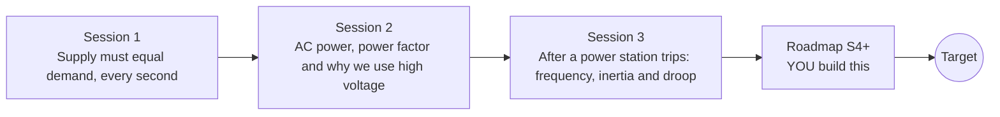

# opengrid

[](https://github.com/KrunalPanchal1995/opengrid/actions/workflows/ci.yml)   [](https://colab.research.google.com/github/KrunalPanchal1995/opengrid/blob/main/sessions/session-01/lesson.ipynb) [](https://krunalpanchal1995.github.io/opengrid/)

**See how the grid balances supply and demand, and what power factor does.**

opengrid teaches why supply must equal demand every second, what power factor and capacitors do, and how frequency falls and recovers after a power station trips, using Python and a browser.

- **Start from zero.** Session 1 needs only school arithmetic and a bar picture of supply and demand.
- **See it move.** Every session ships a slider app that runs in the browser, with labelled graphs.
- **Know you got it right.** Each session ends with a checkpoint that prints PASS or FAIL against hand calculations.
- **Build the missing half.** The repo stops at Session 3 on purpose; the roadmap shows the path to the Target.

[Target](#the-target) · [Who is this for](#who-is-this-for) · [Quick start](#quick-start) · [Sessions](#sessions) · [Roadmap](#roadmap) · [Contribute](#contribute) · [Explainer PDF](docs/explainer.pdf)

> **This repo is incomplete on purpose.** Sessions 1 to 3 are here and fully working. The finished Target below is a preview of what the community can build next. We show you the path, not the code. Sessions 4 and up are yours.

## The Target

A small animated grid: generators on the left, a city load on the right, and a live frequency trace underneath. A generator trips, the trace dives, the governors push back, and the frequency settles just below 50 Hz. A second panel shows a power triangle shrinking as a capacitor bank corrects the power factor. Your goal over the coming sessions: build this panel yourself, with several generators, more realistic governors and a battery that stops the fall.


*Target: a generator trips, the frequency dives and recovers under droop; the power triangle shrinks when a capacitor corrects the power factor*


*Target still: grid, frequency trace and power triangle*

Try it live:

- [Math Visual Studio: explore the Atlas](https://krunalpanchal1995.github.io/studio/)

How the Target was made is shown only as a path in [promo/roadmap.md](promo/roadmap.md).

## Who is this for
**diploma / undergraduate to advanced undergraduate (levels 5-6).** Topic area: Electrical Power and Renewable Energy.

Prerequisites:

- School arithmetic and the idea of a sine wave; trigonometry (cosine, tangent) for Session 2.
- Python 3.10 or newer; if `python --version` works, you are ready. PRIMER.md explains the rest.
- No prior GitHub or electrical engineering experience is needed. Session 3 uses a first-order differential equation, explained step by step.

New to Python? Read [PRIMER.md](PRIMER.md) first (10 minutes).

## Quick start

No installation knowledge needed. You need [Git](https://git-scm.com/downloads) and [Python 3.10+](https://www.python.org/downloads/) (Windows: tick "Add Python to PATH"). On Mac and Linux type `python3` wherever this page says `python`.

```bash
git clone https://github.com/KrunalPanchal1995/opengrid.git
cd opengrid
python start.py 1
```

`start.py` creates a private environment, installs what is needed and runs Session 1 with its checkpoint. Next: `python start.py 2`, `python start.py 3`, or `python start.py test` to check everything. Only a checkpoint: `python start.py check 1`.

Four lines turn the idea of Session 2 into a result (they work as they are): Save it as `try.py` and run it with `python start.py run try.py` (this uses the private environment, where NumPy is installed):

```python
import numpy as np
P, V = 100e3, 400.0                              # 100 kW load on a 400 V supply
for pf in (0.7, 0.95):
    print(pf, round(P / (V * pf), 1), 'A')         # -> 0.7 357.1 A, then 0.95 263.2 A
```

Every session also opens in your browser with sliders (no install): [live apps](https://krunalpanchal1995.github.io/opengrid/). Or use the Colab badge above for the notebook.

## Sessions

| # | Session | Model level | Time | Live app |
|---|---|---|---|---|
| 1 | [Supply must equal demand, every second](sessions/session-01/README.md) | Level 1: conceptual interactive model | 60 min | [open](https://krunalpanchal1995.github.io/opengrid/session-01/) |
| 2 | [AC power, power factor and why we use high voltage](sessions/session-02/README.md) | Level 2: mathematical engineering model | 75 min | [open](https://krunalpanchal1995.github.io/opengrid/session-02/) |
| 3 | [After a power station trips: frequency, inertia and droop](sessions/session-03/README.md) | Level 3: simulation and validation | 90 min | [open](https://krunalpanchal1995.github.io/opengrid/session-03/) |

Each session follows the same six steps: A real-world problem, B concept and theory, C visual explanation, D interactive simulation, E worked example and experiment, F assessment and design challenge. Each ends with `checkpoint.py`, which prints `PASS` or `FAIL` against reference numbers. Session 3 also contains the real-world mini-project: **How much fast battery keeps the frequency above 49.5 Hz?**.

## Architecture



| Folder or file | What is inside |
|---|---|
| `sessions/` | three sessions: README (A-F), `lesson.py`, notebook, live app, exercises, activity sheet, checkpoint |
| `promo/` | the Target: media, live links, and the roadmap (path only) |
| `docs/` | `explainer.tex` and the built `explainer.pdf` |
| `tests/` | runs every lesson and checkpoint headless |
| `start.py` | one command to set up and run anything |
| `QUALITY.md`, `RUBRIC.md` | the quality checklist and the scoring rubric |
| `.github/` | CI, PDF build, Pages deploy, issue and PR templates |

## Roadmap

| Milestone | What you will build | Difficulty |
|---|---|---|
| Session 4: Synthetic inertia from a battery | A battery model with power proportional to RoCoF and a power limit, added to the swing equation. | intermediate |
| Session 5: Limited governor headroom | The governor output clipped to a reserve limit, with a settled-value formula. | intermediate |
| Session 6: Under-frequency load shedding | Staged shedding steps at set frequencies added to the simulation. | advanced |
| Session 7: AC power flow with voltage and reactive power | A three-bus AC power flow solved iteratively. | advanced |
| Session 8: Estimate inertia from a noisy trace | A fitting routine that recovers H from a noisy simulated event. | advanced |

Full detail with a checkpoint per milestone: [promo/roadmap.md](promo/roadmap.md).

## Contribute
New to GitHub? Read [CONTRIBUTING.md](CONTRIBUTING.md); it starts from zero. Pick an issue labelled `good first issue`. Translations into Hindi, Telugu, Tamil and Malayalam are welcome.

<details>
<summary>Development</summary>

```bash
python start.py test        # runs every lesson and checkpoint
```
Lessons use `# %%` cell markers so they open as notebooks in VS Code. See [QUALITY.md](QUALITY.md) for the standard every session meets.
</details>

## License
MIT. See [LICENSE](LICENSE). Media in `promo/media` is (c) Krunal Panchal, CC BY 4.0.

## Acknowledgments
Part of the [PAN IIT OSS](https://hellofoss.tech-iitb.org/projects) open-source teaching collection, modelled on the structure of [openspline](https://github.com/openspline/openspline). Built on ideas from the Math Visual Studio at https://krunalpanchal1995.github.io/studio/.
