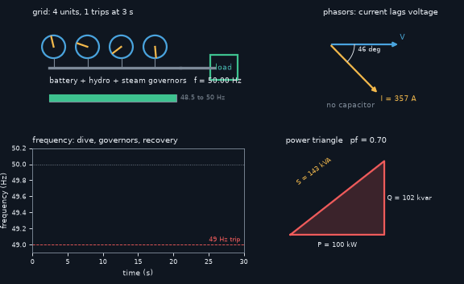
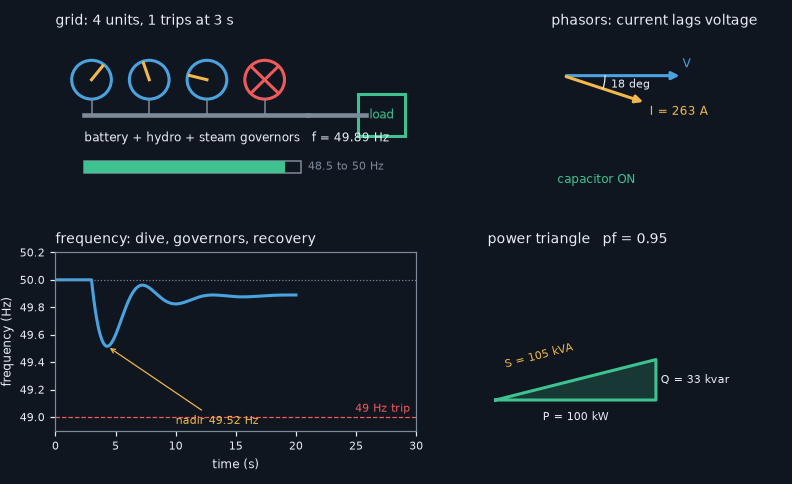

# What you are building toward

A small animated grid: generators on the left, a city load on the right, and a live frequency trace underneath. A generator trips, the trace dives, the governors push back, and the frequency settles just below 50 Hz. A second panel shows a power triangle shrinking as a capacitor bank corrects the power factor. Your goal over the coming sessions: build this panel yourself, with several generators, more realistic governors and a battery that stops the fall.

*Target: a generator trips, the frequency dives and recovers under droop; the power triangle shrinks when a capacitor corrects the power factor*

*Target still: grid, frequency trace and power triangle*

These results come from a private reference build. The code is not published; the roadmap shows the path so you can build your own.

Live links:

- [Math Visual Studio: explore the Atlas](https://krunalpanchal1995.github.io/studio/)
