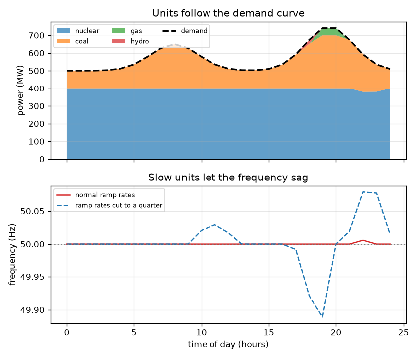
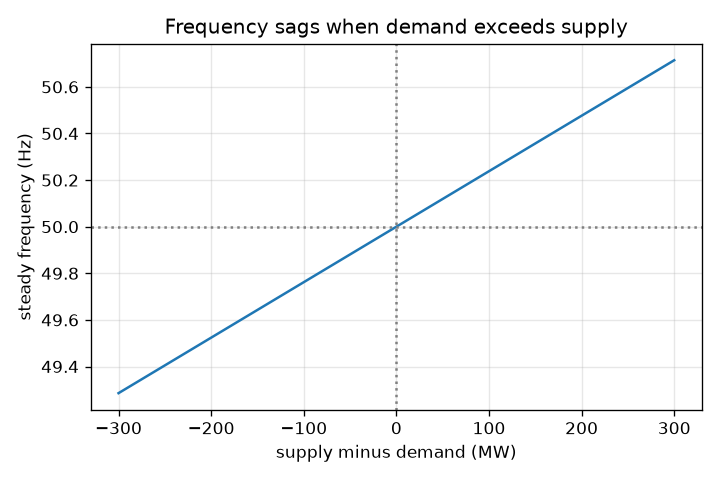

# Session 1: Supply must equal demand, every second

*Level 1 (conceptual interactive model) · about 60 minutes · opengrid*

> This is a simplified educational model. It is not a validated design tool and must not be used for real structures, electrical installations, vehicles, industrial processes or medical decisions.

**Prerequisites**

- School arithmetic and reading a line graph.
- You have read PRIMER.md and run `python start.py 1` once.

**Learning objectives.** After this session you can:

- Explain why supply must equal demand at every moment on an electricity grid.
- Read a daily demand curve and see why generators must ramp up and down.
- Predict the sign and rough size of the frequency change from an imbalance.
- Calculate the frequency for a given supply and demand with the toy rule.

## A. Real-world problem
When you switch on a kettle, a power station somewhere has to produce a little more electricity at that very moment. The grid has almost no storage, so what is produced must match what is used, second by second. What tells the whole country that demand has beaten supply? It is the frequency of the alternating current: 50 Hz when all is well, a little lower when demand wins. How big a shortage makes the frequency sag by 0.1 Hz?

## B. Concept and theory
The grid is one big spinning system. Every power station turbine and many motors turn in step at the grid frequency, 50 Hz in India and Europe. If generators supply less power than the load takes, the missing energy comes out of the rotating machines, they slow, and the frequency falls. If supply is higher than demand, they speed up and the frequency rises. Demand changes through the day (a morning bump, an evening peak and a night dip), so generators ramp up and down. Each unit has a size and a ramp rate (megawatts it can add per hour); cheap units are slow, flexible gas and hydro are fast. In Session 3 we derive the frequency dynamics; here we use their steady-state result for a small toy grid of 1000 MW. The frequency change is 50 Hz times the imbalance divided by (1000 MW times 21). The number 21 is the grid stiffness 1/R + D from Session 3: the droop R = 0.05 gives 20, and the load damping D = 1 gives 1.

| Symbol | Meaning | Unit |
|---|---|---|
| P_supply | power produced by all generators | MW |
| P_demand | power taken by all loads | MW |
| dP | imbalance, supply minus demand | MW |
| f | grid frequency | Hz |
| f0 | nominal frequency, 50 | Hz |
| BASE | size of the toy grid, 1000 | MW |
| K | grid stiffness 1/R + D, equal to 21 | no unit |

**Assumptions**

- The toy grid has one frequency everywhere and no transmission limits.
- The frequency rule is the steady-state (settled) result, not the first seconds.
- Real grids have protection, load shedding and reserves; this model has none of them.
- Educational only: not for operating or planning a real grid.

$$ \Delta P = P_{\mathrm{supply}} - P_{\mathrm{demand}} $$

$$ f = f_0\left(1 + \frac{\Delta P}{\mathrm{BASE}\cdot K}\right),\qquad K = \frac{1}{R}+D = 21 $$

$$ \text{a shortage of } 50\ \mathrm{MW}:\ \ \Delta f = -50\cdot\frac{50}{1000\cdot 21} = -0.119\ \mathrm{Hz} $$

## C. Visual explanation
The first figure stacks the generators through a day: the dashed line is demand, the coloured layers are the units, and the lower panel shows the frequency. With normal ramp rates the units follow the demand and the supply stays within 5 MW of it. When the ramp rates are cut to a quarter the units cannot keep up, the gap grows beyond 40 MW and the frequency dips below 49.95 Hz (the blue dashed curve). The second figure is the frequency rule: a straight line through 50 Hz at zero imbalance that falls as the shortage grows.

*Generators following the daily demand curve; the lower panel shows how slow ramps let the frequency sag.*

*Steady frequency against the imbalance on the 1000 MW toy grid.*

## D. Interactive simulation
Run the lesson (`python start.py 1`), then open the live app: [Session 1: the supply and demand balance](https://krunalpanchal1995.github.io/opengrid/session-01/) (or `app.html` in this folder). Move the demand slider and the flexible generation slider. Watch the supply bar chase the demand bar and the frequency change. Then open the graph view and see how the frequency line slopes down as demand rises.

**Challenge.** Keep the frequency within 0.1 Hz of 50 Hz (here: exactly balanced) with a demand of 800 MW.

## E. Worked example and experiment
**Problem.** Demand is 800 MW but the generators supply only 700 MW on the 1000 MW toy grid. What is the frequency?

1. Imbalance = 700 - 800 = -100 MW (a shortage).
2. Frequency change = 50 * (-100) / (1000 * 21) = -0.238 Hz.
3. Frequency = 50 - 0.238 = 49.762 Hz.
4. Sanity check: half the shortage, 50 MW, should give half the fall: 0.119 Hz. It does.

**Answer.** The frequency settles at 49.762 Hz, a drop of 0.238 Hz.

**Experiment.** Mains frequency can be watched with a cheap frequency meter or a grid-frequency website for your region. Over a day you will see it wander by small fractions of a hertz, dipping when demand picks up faster than generators follow. Model versus reality: our toy rule shows only the settled value and has one frequency, no governors and no operator actions, so it is much simpler and smoother than a real record.

## F. Assessment and design challenge
**Question type A: Conceptual.** Why can the grid not simply store the extra power when demand is low, and why does a shortage show up as a lower frequency rather than a lower voltage?

Hint

Think about where the energy comes from in the first seconds, and what is spinning.

Step-by-step solution

Large-scale storage is expensive and the grid is built to deliver power as it is made, so supply must follow demand. When supply is short, the missing energy is taken from the kinetic energy of the spinning generators and motors, so they slow down; the frequency is their common speed. Voltage is controlled separately (by reactive power, Session 2). A surplus does the opposite and the frequency rises.

**Question type B: Numerical.** On the 1000 MW toy grid, demand is 600 MW and supply is 640 MW. What is the frequency?

Hint

Use f = 50 * (1 + dP / (1000 * 21)) with dP = supply - demand.

Step-by-step solution

dP = +40 MW (a surplus). Frequency = 50 * (1 + 40 / 21000) = 50 + 0.095 = 50.095 Hz. It is above 50 Hz, as expected for a surplus.

**Question type C: Graph and simulation interpretation.** In the frequency graph, what does the slope of the line mean, and what imbalance moves the frequency by 0.1 Hz?

Hint

The slope is the change in frequency per MW of imbalance.

Step-by-step solution

The slope is 50 / 21000 = 0.002381 Hz per MW. A change of 0.1 Hz needs 0.1 / 0.002381 = 42 MW of imbalance. The line falls to the right because more demand means more shortage.

**Question type D: Design and optimisation challenge.** Design: the base units supply a fixed 600 MW and the flexible units can supply 0 to 600 MW. Demand through the evening is between 650 and 750 MW. Choose the flexible output for each demand so the frequency stays within 0.1 Hz of 50 Hz, and say what this tells you about how fast the flexible units must ramp.

Hint

You need supply within about 42 MW of demand at every moment.

Step-by-step solution

Flexible output should be demand minus 600, within 42 MW: about 50 MW at 650 MW demand and about 150 MW at 750 MW demand. So the flexible units must be able to add about 100 MW over the hours between, and follow it closely; if they ramp too slowly the gap exceeds 42 MW and the frequency leaves the 0.1 Hz band. Trade-off: fast units (gas, hydro, batteries) are more expensive than slow base units.

Score yourself with [RUBRIC.md](../../RUBRIC.md). Print the [activity sheet](activity_sheet.md) to work on paper.

## Common misconceptions
| Common misconception | What is actually true |
|---|---|
| The grid frequency is set by the power stations deciding on a number. | It is a result of balance: all machines turn together and the frequency rises or falls with the energy imbalance. |
| A small shortage makes the lights go out. | A small shortage only lowers the frequency a little; trouble comes when the shortage is large or lasts, and then protection and load shedding act. |
| Supply and demand are balanced once per hour. | They are balanced continuously; the hour-by-hour dispatch only sets the plan, and fast reserves absorb the second-by-second differences. |

## Glossary
- **frequency**: how many times per second the alternating current repeats; 50 Hz here
- **demand**: the power the loads are taking, in megawatts
- **ramp rate**: how fast a generator can raise or lower its output, in MW per hour
- **merit order**: loading the cheapest generators first
- **imbalance**: supply minus demand
- **droop R**: the governor setting that decides how much a generator slows down when the frequency drops; 0.05 here, so 1/R = 20
- **load damping D**: the part of the frequency response that comes from demand itself shrinking as the frequency falls; 1 here

## Finish
1. Do the three coding tasks in [exercises.md](exercises.md).
2. Run `python start.py 1` again after your changes. It ends with the checkpoint; when it prints `PASS`, you are done. (Checkpoint only: `python start.py check 1`.)

Next: [Session 2](../session-02/README.md)
