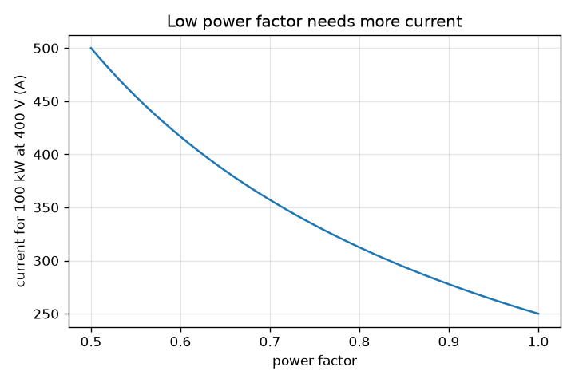
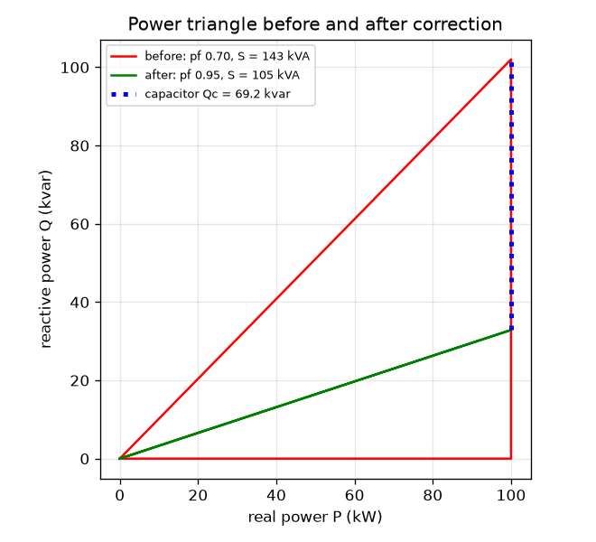

# Session 2: AC power, power factor and why we use high voltage

*Level 2 (mathematical engineering model) · about 75 minutes · opengrid*

> This is a simplified educational model. It is not a validated design tool and must not be used for real structures, electrical installations, vehicles, industrial processes or medical decisions.

**Prerequisites**

- Session 1: supply, demand and frequency.
- Sine and cosine; the tangent of an angle (explained in Section B).

**Learning objectives.** After this session you can:

- Define real, reactive and apparent power and draw the power triangle.
- Compute the current a load draws at a given power factor.
- Size a capacitor bank (kvar and microfarad) to correct the power factor.
- Show that ten times the transmission voltage gives one hundredth of the line loss.

## A. Real-world problem
A workshop takes 100 kW from a 400 V supply. With a power factor of 0.70 the cable and transformer must carry 357.1 A; with a power factor of 0.95 only 263.2 A for the very same useful power. Utilities charge extra for a low power factor, and long lines lose power as heat. What is power factor, how big a capacitor fixes it, and why do power lines use such high voltages?

## B. Concept and theory
With alternating current the current can lag the voltage by an angle phi, because motors and transformers store energy in magnetic fields. The useful power is P = V I cos(phi) (watts); the part that sloshes back and forth is the reactive power Q = V I sin(phi) (var); the wires must carry the apparent power S = V I (volt-amperes). They form a right triangle: S squared is P squared plus Q squared, and the power factor is cos(phi) = P / S. For the same real power, a lower power factor means a larger current: I = P / (V pf). A capacitor supplies reactive power locally, so the supply carries less. To lift the power factor from pf1 to pf2 at constant P the bank must supply Qc = P (tan phi1 - tan phi2); across a voltage V, a capacitor C supplies Qc = 2 pi f C V squared, so C = Qc / (2 pi f V squared). The same ideas apply to three-phase systems, where P = sqrt(3) V_line I pf. Finally, a line of resistance R wastes I squared times R; for a fixed power, I = P / V, so loss = P squared R / V squared: ten times the voltage gives one hundredth of the loss.

| Symbol | Meaning | Unit |
|---|---|---|
| V | RMS voltage | volt |
| I | RMS current | ampere |
| phi | angle by which current lags voltage | degrees |
| P | real power | watt (W) or kW |
| Q | reactive power | var or kvar |
| S | apparent power | VA or kVA |
| pf | power factor, cos(phi) | no unit |
| Qc | reactive power from the capacitor | var or kvar |
| C | capacitance | farad (microfarad) |
| R | line resistance | ohm |

**Assumptions**

- Single-phase sinusoidal waveforms with RMS values (three-phase uses the same triangle).
- The load is inductive (current lags) and its real power stays the same after correction.
- The capacitor is ideal and sits across the load voltage.
- Simplified for learning: real installations must be designed by qualified engineers.

$$ P = VI\cos\varphi,\qquad Q = VI\sin\varphi,\qquad S = VI,\qquad S^2 = P^2+Q^2,\qquad \mathrm{pf}=\cos\varphi=\frac{P}{S} $$

$$ I = \frac{P}{V\,\mathrm{pf}} $$

$$ Q_c = P\,(\tan\varphi_1-\tan\varphi_2),\qquad C=\frac{Q_c}{2\pi f V^2} $$

$$ P_{\mathrm{loss}} = I^2R = \frac{P^2R}{V^2\,\mathrm{pf}^2} $$

## C. Visual explanation
The first figure is the power triangle of a 100 kW load. Before correction (pf 0.70) the triangle is tall: Q is 102.0 kvar and S is 142.9 kVA. After the capacitor (pf 0.95) the real power is unchanged but Q falls to 32.9 kvar and S to 105.3 kVA. The blue dotted segment is the capacitor, Qc = 69.2 kvar. The second figure plots current against power factor for the same 100 kW at 400 V: the curve is a hyperbola, 250 A at unity, 357.1 A at 0.70 and 500 A at 0.50.

*Current for 100 kW at 400 V against the power factor.*

*The power triangle before (pf 0.70) and after (pf 0.95) correction; the capacitor is the blue dotted segment.*

## D. Interactive simulation
Run the lesson (`python start.py 2`), then open the live app: [Session 2: power triangle and power factor correction](https://krunalpanchal1995.github.io/opengrid/session-02/) (or `app.html` in this folder). Set the load, the existing power factor and the target power factor. Watch the triangle, then open the current graph and read the current before and after. Note the capacitor size and its capacitance in microfarad.

**Challenge.** Choose the 50 kW load at power factor 0.75 and a target of 0.95 so that the capacitor size is between 27 and 28.5 kvar.

## E. Worked example and experiment
**Problem.** A 100 kW single-phase load on 400 V has pf 0.70. Find its current, the capacitor needed to reach pf 0.95, the capacitance at 50 Hz, and the new current.

1. Current before: I = 100000 / (400 * 0.70) = 357.1 A.
2. tan(phi1) = tan(acos 0.70) = 1.0202 and tan(phi2) = tan(acos 0.95) = 0.3287.
3. Qc = 100 kW * (1.0202 - 0.3287) = 69.15 kvar.
4. C = 69150 / (2 pi * 50 * 400^2) = 0.001376 F = 1376 microfarad.
5. Apparent power after: S = 100 / 0.95 = 105.3 kVA, so I = 105260 / 400 = 263.2 A (down from 357.1 A).

**Answer.** Qc = 69.15 kvar, C = 1376 microfarad, and the current falls from 357.1 A to 263.2 A.

**Experiment.** With a small mains-isolated learning kit or a clamp meter on a workshop motor you can read V, I and the power factor from a power analyser, then switch in a capacitor bank (done only by a qualified person) and see the current drop at the same real power. Model versus reality: real loads change with load level, harmonics distort the waveform, capacitors age and can resonate with the network, and the model gives only the ideal sizes.

## F. Assessment and design challenge
**Question type A: Conceptual.** Why does a low power factor waste capacity even though the reactive power does no useful work, and how does a capacitor help?

Hint

Think about what the wires and transformers must carry.

Step-by-step solution

Wires and transformers carry the current, and the current follows the apparent power S, not just the real power P. Reactive power adds to the current without adding useful work, so for the same P the current is larger (I = P / (V pf)), which heats the wires more (I squared R) and uses up capacity. A capacitor supplies the reactive power next to the load, so the supply does not have to carry it.

**Question type B: Numerical.** A 30 kW single-phase load on 230 V has pf 0.8. Find its current, its reactive power, and the current if the pf were corrected to 1.

Hint

I = P / (V pf). Q = P tan(acos pf).

Step-by-step solution

I = 30000 / (230 * 0.8) = 163.0 A. Q = 30 * tan(36.87 degrees) = 22.5 kvar. At pf 1: I = 30000 / 230 = 130.4 A. Sanity check: the current is lower and the ratio is 0.8.

**Question type C: Graph and simulation interpretation.** From the current-against-pf graph (100 kW, 400 V), what are the currents at pf 1 and pf 0.5, and what does that tell you?

Hint

Evaluate I = P / (V pf).

Step-by-step solution

At pf 1 the current is 250 A and at pf 0.5 it is 500 A, twice as big. The curve rises steeply at low pf, so the saving from correcting from 0.5 to 0.7 is much larger than from 0.9 to 1.

**Question type D: Design and optimisation challenge.** Design: a 50 kW load has pf 0.75 and must reach 0.95 at 400 V, 50 Hz. Find the exact capacitor size and capacitance. A supplier only stocks a 30 kvar bank: what pf does it give? Discuss the trade-offs.

Hint

Qc = P (tan phi1 - tan phi2). With 30 kvar installed, the remaining reactive power is Q1 - 30 kvar.

Step-by-step solution

Exact: Qc = 27.66 kvar, which is 550 microfarad. The load has Q1 = 44.10 kvar; with 30 kvar installed, 14.10 kvar remains and pf = 50 / sqrt(50^2 + 14.10^2) = 0.9624, a little better than 0.95 but it over-corrects slightly at light load (leading current is bad). Trade-offs: bigger banks cost more, over-correction risks voltage rise and resonance, so engineers use stepped banks that switch with the load.

Score yourself with [RUBRIC.md](../../RUBRIC.md). Print the [activity sheet](activity_sheet.md) to work on paper.

## Common misconceptions
| Common misconception | What is actually true |
|---|---|
| A low power factor means the load uses little power. | The real power is the same; the load just draws extra current for the reactive part. |
| Reactive power is wasted and heats the load. | It is not consumed; it swaps back and forth with the field, but the current it needs still heats the wires. |
| A bigger capacitor is always better. | Too large a capacitor over-corrects (current leads) and can raise voltage or resonate with the network. |
| Transmission uses high voltage because it makes more power. | The same power is moved with a smaller current, which cuts the I squared R loss. |

## Glossary
- **real power**: the power that does useful work, in watts
- **reactive power**: power that swaps with magnetic or electric fields, in var
- **apparent power**: the product V times I, in volt-amperes
- **power factor**: cos(phi), the fraction of apparent power that is real
- **var**: volt-ampere reactive, the unit of reactive power
- **RMS**: root mean square, the effective value of an alternating quantity

## Finish
1. Do the three coding tasks in [exercises.md](exercises.md).
2. Run `python start.py 2` again after your changes. It ends with the checkpoint; when it prints `PASS`, you are done. (Checkpoint only: `python start.py check 2`.)

Next: [Session 3](../session-03/README.md)
