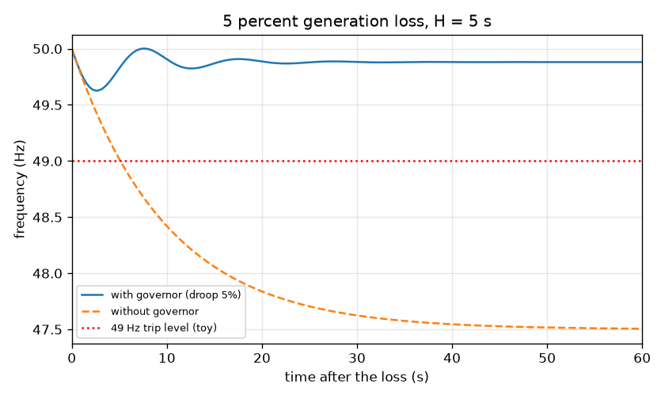
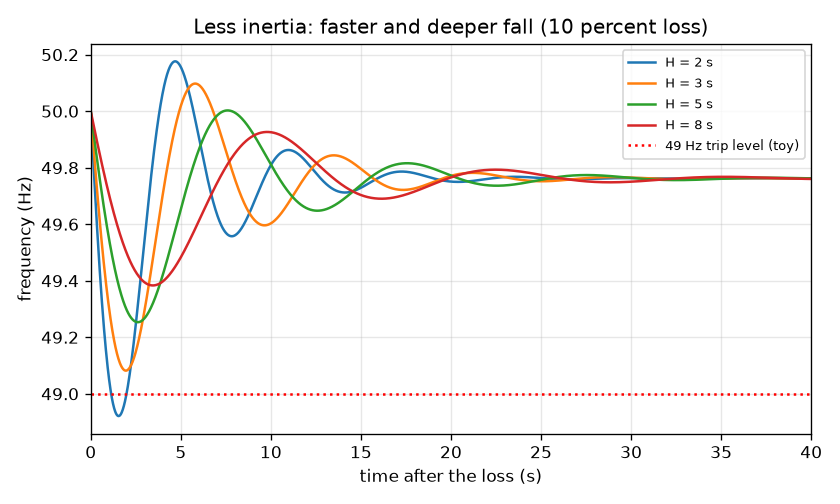

# Session 3: After a power station trips: frequency, inertia and droop

*Level 3 (simulation and validation) · about 90 minutes · opengrid*

> This is a simplified educational model. It is not a validated design tool and must not be used for real structures, electrical installations, vehicles, industrial processes or medical decisions.

**Prerequisites**

- Session 1: frequency and the balance of supply and demand.
- Session 2: power in per unit helps but is explained here.
- An idea of what a differential equation does (rate of change); the RK4 method is explained in the lesson.

**Learning objectives.** After this session you can:

- State the swing equation in per unit with inertia constant H, damping D and governor droop R.
- Solve it with your own RK4 and validate the start slope and the final value with hand formulas.
- Compare the frequency with and without governor response and with different inertia.
- Solve a three-bus DC power flow and check power balance; find a battery size for a nadir target.

## A. Real-world problem
A large power station suddenly trips and the grid loses 5 percent of its generation. Demand has not changed, so the rotating machines start to slow. How fast does the frequency fall, how low does it go, and where does it settle? And why do grid operators worry as more solar and wind (which have no big spinning mass) replace conventional plants? This is a toy illustration of the real study done by system operators.

## B. Concept and theory
Treat the whole grid as one aggregate generator with stored kinetic energy. The inertia constant H is the stored energy in seconds of rated power (about 5 s is typical for a conventional grid). Let dw = (f - f0) / f0 be the per-unit frequency deviation and dP the sudden loss (per unit). The swing equation is 2H d(dw)/dt = Pm - dP - D dw, where D is the damping from loads that use less power at lower frequency. Primary governor control with droop R (about 5 percent typical) raises the mechanical power as the frequency falls: Pm follows -dw / R, here with a combined turbine and governor lag Tg of 5 s. A fast battery can add power in proportion to the deviation, up to its size B, with a short lag. Two hand formulas test the solver: right after the loss the governor has not moved, so the rate of change of frequency is RoCoF = -f0 dP / (2H); once everything settles, the derivative is zero and Pm = -dw / R, giving df = -f0 dP / (1/R + D). Less inertia (more solar and wind) means a faster and deeper fall. A three-bus DC power flow (a stretch topic) solves the linear system B theta = P for the bus angles, and each line carries (theta_i - theta_j) / x.

| Symbol | Meaning | Unit |
|---|---|---|
| H | inertia constant | s |
| dw | per-unit frequency deviation (f - f0) / f0 | no unit |
| dP | sudden generation loss, per unit on the generation base | pu |
| D | load damping, 1 | pu |
| R | governor droop, 0.05 | pu |
| Pm | extra mechanical power from the governor | pu |
| Tg | governor and turbine lag, 5 | s |
| B | battery size | pu |
| x | line reactance | pu |
| theta | bus voltage angle | radian |

**Assumptions**

- One aggregate generator stands for the whole grid; there are no network limits in the frequency model.
- The governor is a simple first-order lag with no dead band and no power limit; the battery is a proportional response with a size limit.
- The DC power flow assumes 1 pu voltages, small angles and lossless lines.
- Toy illustration only. Real grids have protection, load shedding, many machine types and controls; never use this for grid operation.

$$ 2H\,\frac{d(\Delta\omega)}{dt} = P_m + P_b - \Delta P - D\,\Delta\omega,\qquad \Delta\omega=\frac{f-f_0}{f_0} $$

$$ T_g\,\frac{dP_m}{dt} = -\frac{\Delta\omega}{R} - P_m $$

$$ \mathrm{RoCoF} = -\frac{f_0\,\Delta P}{2H},\qquad \Delta f_{\infty} = -\frac{f_0\,\Delta P}{1/R + D} $$

$$ B\,\boldsymbol{\theta} = \mathbf{P},\qquad P_{ij} = \frac{\theta_i-\theta_j}{x_{ij}} $$

## C. Visual explanation
The first figure shows the frequency after a 5 percent loss at H = 5 s. With the governor (blue) it starts to fall at 0.25 Hz per second, bottoms out at 49.627 Hz and settles at 49.881 Hz. Without the governor (dashed) it keeps falling until the load damping alone stops it, at 47.500 Hz, far below the 49 Hz toy trip level. The second figure uses a 10 percent loss and four inertia values: the smaller H, the steeper and deeper the fall, and H = 2 s crosses the 49 Hz line.

*A 5 percent loss at H = 5 s: with governor (nadir 49.627 Hz, settles at 49.881 Hz) and without (47.500 Hz).*

*A 10 percent loss with H = 2, 3, 5 and 8 s: less inertia gives a faster and deeper fall.*

## D. Interactive simulation
Run the lesson (`python start.py 3`), then open the live app: [Session 3: frequency after a sudden loss](https://krunalpanchal1995.github.io/opengrid/session-03/) (or `app.html` in this folder). Change H, the size of the loss, the droop and the battery size. Watch the frequency trace and the nadir marker, and compare the blue curve with the grey no-governor curve. Compare the RoCoF and the final value with the hand formulas in the readout.

**Challenge.** Meet both limits at once: an initial rate of change of frequency of no more than 0.5 Hz/s in size, and a settled frequency of at least 49.9 Hz.

## E. Worked example and experiment
**Problem.** A 5 percent loss hits a grid with H = 5 s, D = 1 and droop R = 0.05. Find the initial RoCoF and the settled frequency by hand, then compare with the RK4 simulation.

1. Initial RoCoF = -f0 dP / (2H) = -50 * 0.05 / (2 * 5) = -0.250 Hz/s.
2. Stiffness 1/R + D = 20 + 1 = 21.
3. Final deviation = -50 * 0.05 / 21 = -0.119 Hz, so the settled frequency is 49.881 Hz.
4. Without a governor the final deviation is -50 * 0.05 / 1 = -2.5 Hz, so 47.500 Hz.
5. The RK4 simulation gives a start slope of about -0.249 Hz/s, a settled value of 49.881 Hz with the governor and 47.500 Hz without; the nadir with the governor is 49.627 Hz.

**Answer.** RoCoF is -0.250 Hz/s, the frequency settles at 49.881 Hz with the governor (47.500 Hz without it), and the lowest point is 49.627 Hz.

**Experiment.** Real operators publish frequency records after generator trips (for example grid-operator event reports). Fit a straight line to the first second after the trip to read the RoCoF, then compare the settled value with your own estimate from the droop and the size of the loss. Model versus reality: real systems have many machines with different governors, load shedding, wind and solar behaviour and measurement noise, so real curves have wiggles that the one-generator toy lacks.

## Real-world application and mini-project: How much fast battery keeps the frequency above 49.5 Hz?
A low-inertia grid (H = 3 s) must survive the sudden loss of 8 percent of its generation without the frequency falling below 49.5 Hz. The governors alone are not enough. Use `simulate_frequency` and `smallest_battery` from Session 3 to find the smallest fast battery, in steps of 0.005 per unit. This is a toy study for learning, not a grid design.

**Deliverable:** A script that prints the nadir for batteries of 0 to 0.06 per unit in steps of 0.005, names the smallest battery that keeps the nadir at or above 49.5 Hz, and saves a figure with the frequency traces with no battery and with that battery.

**Success looks like:** The smallest battery is reported (it is 0.035 per unit, with a nadir of 49.531 Hz), while 0.030 per unit is shown to fall short and the no-battery nadir is 49.266 Hz.

## F. Assessment and design challenge
**Question type A: Conceptual.** Why does a grid with a lot of solar and wind (little spinning mass) see a faster and deeper frequency fall after the same loss?

Hint

Look at where H enters the RoCoF formula.

Step-by-step solution

Less spinning mass means a smaller H. The initial rate of change is -f0 dP / (2H), so a smaller H gives a steeper fall; the governors need several seconds to react, so a faster fall also reaches a deeper low point before they catch up. The settled value does not depend on H, only on droop and damping.

**Question type B: Numerical.** An 8 percent loss hits a grid with H = 4 s. Find the initial RoCoF. Then for a 5 percent loss with droop R = 0.04 and D = 1, find the settled frequency.

Hint

RoCoF = -f0 dP / (2H). Final = f0 - f0 dP / (1/R + D).

Step-by-step solution

RoCoF = -50 * 0.08 / (2 * 4) = -0.5 Hz/s. For the second part, 1/R + D = 25 + 1 = 26 and the deviation is -50 * 0.05 / 26 = -0.096 Hz, so the frequency settles at 49.904 Hz.

**Question type C: Graph and simulation interpretation.** In the inertia figure (10 percent loss), compare the initial slopes for H = 2 s and H = 5 s, and say which curve crosses 49 Hz.

Hint

Use the RoCoF formula for each curve.

Step-by-step solution

H = 2 s: -50 * 0.10 / 4 = -1.25 Hz/s. H = 5 s: -50 * 0.10 / 10 = -0.5 Hz/s. The H = 2 s curve is 2.5 times steeper and dips to 48.921 Hz, below the 49 Hz trip level; the H = 5 s curve bottoms out at 49.253 Hz and does not cross.

**Question type D: Design and optimisation challenge.** Design: after an 8 percent loss on a grid with H = 3 s the nadir must stay at or above 49.5 Hz. The nadir with no battery is 49.266 Hz. Find the smallest fast battery (in steps of 0.005 pu), and discuss what else could achieve it.

Hint

Run smallest_battery(0.08, 3.0) and print the nadir for the sizes just below it.

Step-by-step solution

The smallest battery is 0.035 pu, which gives a nadir of 49.531 Hz; 0.030 pu falls short. Alternatives: more inertia (synchronous condensers), a smaller largest loss, stiffer (lower) droop, or a faster governor. Trade-offs: a battery responds in a fraction of a second but costs money per MW and has limited energy; extra inertia is slower to add but helps the first second.

Score yourself with [RUBRIC.md](../../RUBRIC.md). Print the [activity sheet](activity_sheet.md) to work on paper.

## Common misconceptions
| Common misconception | What is actually true |
|---|---|
| The lowest frequency is the same as the final frequency. | The nadir is the lowest point, reached within seconds; the settled value is higher once governors have acted. |
| More inertia lowers the final frequency error. | Inertia changes how fast the frequency falls and the depth of the nadir; the settled value depends on droop and damping. |
| Droop control brings the frequency back to exactly 50 Hz. | Primary droop control only stops the fall at a lower value; secondary control later restores 50 Hz. |
| A DC power flow is a power flow with direct current. | It is a linear approximation of the AC power flow for real power, using small angles and 1 pu voltages. |

## Glossary
- **inertia constant H**: stored kinetic energy of the rotating machines in seconds of rated power
- **RoCoF**: rate of change of frequency, in hertz per second
- **nadir**: the lowest frequency reached after a disturbance
- **droop**: how much the governor opens the valves for a given frequency fall
- **per unit**: a value divided by a chosen base value, so it has no unit
- **slack bus**: the bus in a power flow that takes the power balance and has angle zero
- **under-frequency trip**: protection that disconnects equipment when frequency is too low

## Finish
1. Do the three coding tasks in [exercises.md](exercises.md).
2. Run `python start.py 3` again after your changes. It ends with the checkpoint; when it prints `PASS`, you are done. (Checkpoint only: `python start.py check 3`.)

Next: the [roadmap](../../promo/roadmap.md). Session 4 is yours to build.
